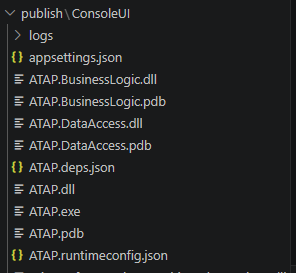

# ATAP — материалы ЛР6 и ЛР7

## Логирование, конфигурирование и сборка компонентов

### Состав компонентов

Приложение собрано из трёх независимых компонентов (единиц развёртывания):

- `ATAP.DataAccess.dll` — компонент доступа к данным
- `ATAP.BusinessLogic.dll` — компонент бизнес-логики
- `ATAP.exe` — технологический UI (ConsoleUI), точка входа

### Логирование

Реализовано с помощью **Serilog** с двумя синками:
- **Консоль** — уровень Information и выше
- **Файл** (`logs/atap-.log`, ротация по дням) — уровень Debug и выше, все исключения

Логируются: начало/конец сессии, действия пользователя по ролям (вход, регистрация, запросы к БД, выгрузка CSV), все исключительные ситуации.

### Конфигурирование

Параметры вынесены в `appsettings.json`:
- строка подключения к БД (`ConnectionStrings:DefaultConnection`)
- параметры бизнес-логики: `MaxFlightsPreview`, `MaxReportPreview`

### Уточнённые диаграммы C4

Обновлены диаграммы **L2** и **L3** — добавлен контейнер `ConsoleUI` (технологический UI). Компоненты `ATAP.BusinessLogic` и `ATAP.DataAccess` показаны как общие сборки, используемые обоими контейнерами (Blazor Server App и ConsoleUI).

### Директория собранных компонентов

*Рисунок — Директория `publish/ConsoleUI/` с собранными компонентами приложения*

---

## Реализация GUI (Blazor Server, MVVM)

Диаграмма компонента GUI — в [README, раздел 10, L4](README.md#l4-код).
