# Air Traffic Analytics Platform (ATAP)

Веб-приложение для аналитики воздушного движения: хранит и обрабатывает данные о воздушных
судах, рейсах и их перемещениях, показывает текущие позиции судов на карте и даёт аналитическую
витрину загруженности аэропортов.

Содержание:
[1. Цель](#1-цель-проблема-и-возможность) ·
[2. Роли](#2-роли) ·
[3. Требования](#3-требования) ·
[4. Use-case](#4-use-case-диаграмма) ·
[5. BPMN](#5-bpmn-основных-бизнес-процессов) ·
[6. Сценарии](#6-пользовательские-сценарии) ·
[7. ER](#7-er-диаграмма-сущностей) ·
[8. Стек](#8-технологический-стек) ·
[9. БД](#9-диаграмма-базы-данных) ·
[10. C4](#10-диаграммы-c4) ·
[11. Экраны](#11-черновые-экраны-web-приложения) ·
[12. ADR](#12-архитектурные-решения-adr) ·
[13. Связь сценариев](#13-связь-сценариев-с-требованиями-сущностями-и-экранами)

---

## 1. Цель, проблема и возможность

**Цель.** Спроектировать веб-приложение ATAP: роли и сценарии, требования, доменную модель,
архитектуру и экраны — в объёме, достаточном для проектирования REST API и реализации GUI.

**Предметная область.** Воздушное судно (код ICAO24, модель, страна регистрации), рейс (позывной,
время появления), позиция (координаты, высота, скорость, курс), аэропорт (коды ICAO/IATA,
координаты), карта и аналитическая витрина загруженности аэропортов.

**Проблема.** Большинство сервисов мониторинга полётов либо не имеют аналитических инструментов,
либо требуют платной подписки:

| Сервис | Тип | Аналитика | Карта | Источник данных | API | Бесплатно |
|---|:--:|:--:|:--:|:--:|:--:|:--:|
| OpenSky Network | веб | — | + | краудсорсинг | + | + |
| Flightradar24 | веб + моб. | — | + | мультиисточниковый | — | + |
| FlightAware | веб + моб. | + | + | мультиисточниковый | — | + |
| ADSBexchange | веб | — | + | краудсорсинг | + | + |
| RadarBox | веб + моб. | + | + | мультиисточниковый | — | + |
| **ATAP** | веб | + | + | открытые API | — | + |

**Возможность.** ATAP сочетает открытые данные (OpenSky) с анализом загруженности аэропортов:

- карта текущих позиций воздушных судов;
- витрина `mart_airport_congestion`: вход и выход судов из зоны аэропорта, длительность, вылет/прилёт;
- выгрузка CSV и сохранение параметров отчёта.

Это помогает авиакомпаниям оптимизировать расписание и эффективнее использовать взлётно-посадочные полосы.

---

## 2. Роли

| Роль | Кто это | Возможности |
|---|---|---|
| **Гость** | не вошёл в систему; в БД не хранится | карта, регистрация, вход |
| **Аналитик** (`analyst`) | роль по умолчанию после регистрации | + витрина, фильтры карты и витрины, CSV, сохранённые отчёты, выход |
| **Администратор** (`admin`) | назначается администратором | + управление пользователями, переход в интерфейс Airflow для мониторинга загрузки данных |

Управление самим Airflow (вход, параметры, перезапуск DAG) выполняется в родном UI Airflow и в
ATAP не входит.

---

## 3. Требования

### 3.1 Функциональные требования

Статус: ✅ реализовано · ❌ не реализовано.

| ID | Требование | Роль | Статус |
|---|---|---|---|
| FR-01 | Регистрация по логину, email и паролю; логин и email уникальны; роль `analyst` | Гость | ✅ |
| FR-02 | Вход по логину и паролю, создание сессии | Гость | ✅ |
| FR-03 | Выход из аккаунта | Аналитик | ✅ |
| FR-04 | Карта текущих позиций судов, автообновление каждые 5 мин | Гость | ✅ |
| FR-05 | Аэропорты на карте | Гость | ✅ |
| FR-06 | Фильтры карты: видимая область, высота, страна | Аналитик | ❌ |
| FR-07 | Витрина загруженности за период, по одному аэропорту или по всем | Аналитик | ✅ |
| FR-08 | Проверка периода: дата начала ≤ даты окончания | Аналитик | ✅ |
| FR-09 | Счётчики: записей, вылетов, прилётов | Аналитик | ✅ |
| FR-10 | Выгрузка витрины в CSV | Аналитик | ✅ |
| FR-11 | Сохранение отчёта: имя + аэропорт + период | Аналитик | ✅ |
| FR-12 | «Мои отчёты»: список, повторная выгрузка CSV, удаление | Аналитик | ✅ |
| FR-13 | Список пользователей с ролью и датой регистрации | Админ | ✅ |
| FR-14 | Добавление пользователя с ролью | Админ | ✅ |
| FR-15 | Редактирование пользователя, смена пароля | Админ | ✅ |
| FR-16 | Удаление пользователя; удалить `admin` и себя нельзя | Админ | ✅ |
| FR-17 | Загрузка позиций (раз в 5 мин) и рейсов (раз в час) из OpenSky в `stg` | Система (Airflow) | ❌ |
| FR-18 | Расчёт витрины: позиции в радиусе `analysis_radius` и высота ≤ 610 м | Система | ✅ |
| FR-19 | Обновление matview карты `mart.current_flights_map` | Система | ✅ |
| FR-20 | Кэширование справочников и отчётов витрины в Redis | Система | ✅ |

### 3.2 Нефункциональные требования

| ID | Категория | Требование | Как проверить |
|---|---|---|---|
| **NFR-P1** | Производительность | Позиции для карты: при нагрузке до **50 запросов в секунду** и **500 судах** на карте **95 % запросов** должны отвечать не дольше **1000 мс** (самые медленные 5 % — не в счёт) | k6, 5 мин нагрузки |
| **NFR-R2** | Надёжность | Отказ Redis: **0** ошибок 5xx, время ответа — как без кэша | остановить Redis, пройти сценарии 3–4 |
| **NFR-S1** | Безопасность | **0** паролей в открытом виде; хэш с солью (PBKDF2 ≥ 100 000 итераций) | SQL-проверка `dds.users`, unit-тест |

---

## 4. Use-case диаграмма

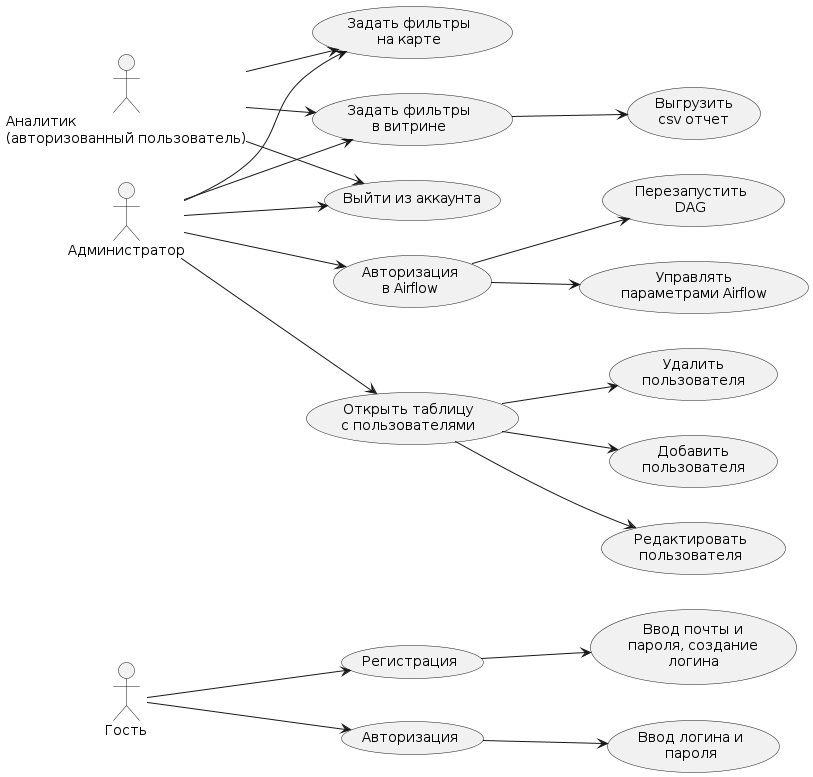

---

## 5. BPMN основных бизнес-процессов

Процессы 1–3 нелинейные: у каждого есть развилки и возвраты к предыдущим шагам.

### Процесс 1: Регистрация и авторизация пользователя
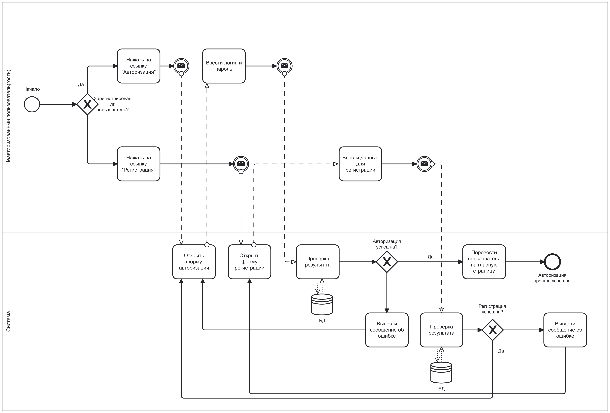

### Процесс 2: Выгрузка аналитического отчёта
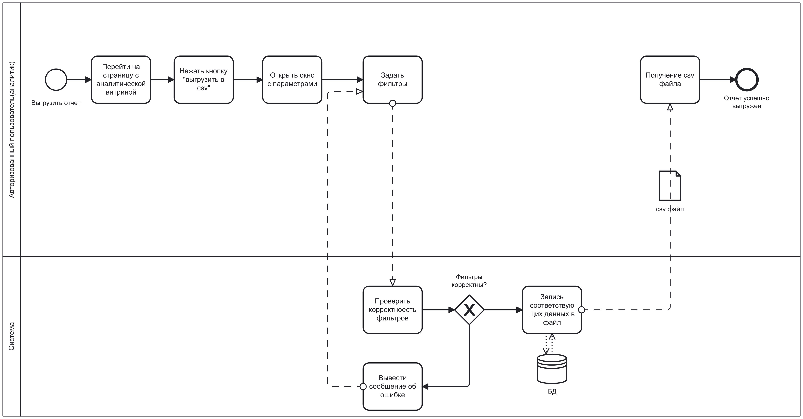

### Процесс 3: Управление пользователями
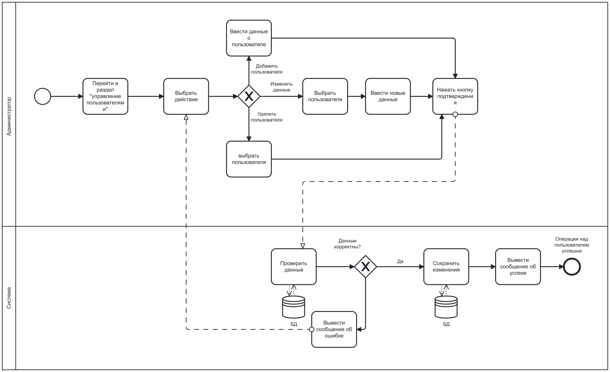

### Процесс 4: Загрузка данных для аналитической витрины
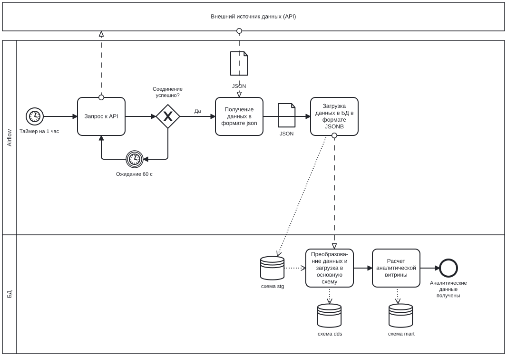

### Процесс 5: Загрузка данных для отображения на карте
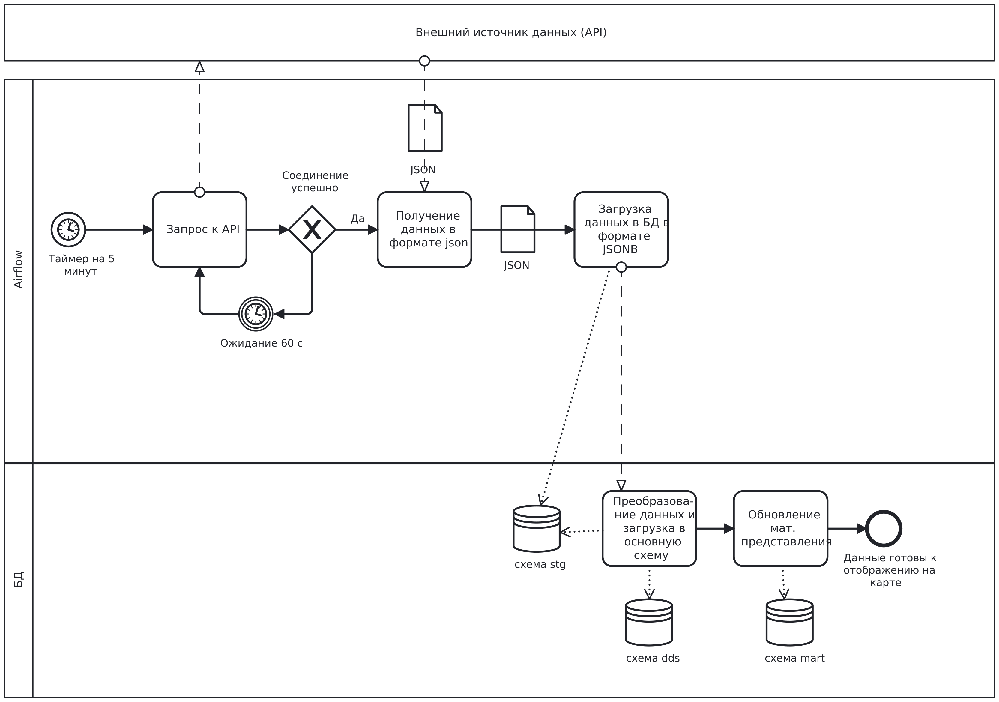

---

## 6. Пользовательские сценарии

### Сценарий 1: Регистрация нового пользователя (FR-01)

| Шаг | Действие | Результат |
|---|---|---|
| 1 | Гость открывает главную страницу | Отображаются переходы «Карта рейсов», «Войти», «Регистрация» и подсказка, что аналитика доступна после входа |
| 2 | Нажимает «Регистрация» | Открывается форма регистрации |
| 3 | Заполняет логин, email, пароль | Поля заполнены |
| 4 | Нажимает «Зарегистрироваться» | Система проверяет заполненность полей и уникальность логина и email |
| 5 | Данные корректны | Создаётся учётная запись с ролью `analyst`, показана ссылка «Войти» |
| 6 | Логин или email заняты | Показано сообщение об ошибке, гость остаётся на форме |

**Критерии приёмки:**
- **Успех:** В `dds.users` появилась строка с `role='analyst'`, при этом `password_hash` не равен введённому паролю.
- **Ошибка:** Логин или email заняты → новая строка не создаётся.
- **Ошибка:** Пустое поле → запрос к БД не выполняется, показано, какое поле не заполнено.
- **Ошибка:** Пароль короче 8 или длиннее 128 символов → учётная запись не создаётся, показано сообщение о требованиях к паролю.

### Сценарий 2: Авторизация пользователя (FR-02, FR-03)

| Шаг | Действие | Результат |
|---|---|---|
| 1 | Гость открывает главную страницу | Отображаются переходы «Карта рейсов», «Войти», «Регистрация» и подсказка, что аналитика доступна после входа |
| 2 | Нажимает «Войти» | Открывается форма авторизации |
| 3 | Вводит логин и пароль | Поля заполнены |
| 4 | Нажимает «Войти» или Enter | Система проверяет учётные данные |
| 5 | Данные верны | Создаётся сессия; в меню появляются «Аналитика» и «Мои отчёты», у admin ещё «Пользователи» |
| 6 | Данные неверны | Сообщение «Неверный логин или пароль», гость остаётся на форме |

**Критерии приёмки:**
- **Успех:** Сессия (имя, роль, id) сохраняется в зашифрованном `ProtectedLocalStorage` и переживает перезагрузку страницы.
- **Ошибка:** Неизвестный логин и неверный пароль дают одно и то же сообщение (не раскрывается, что именно неверно).
- **Ошибка:** После «Выхода» страницы `/analytics`, `/reports`, `/admin` предлагают войти и не показывают данные.

### Сценарий 3: Анализ загруженности аэропорта (Аналитик; FR-07…FR-12)

| Шаг | Действие | Результат |
|---|---|---|
| 1 | Аналитик авторизуется | Открывается главная страница |
| 2 | Переходит в раздел «Аналитика» | Отображаются список аэропортов и поля периода |
| 3 | Выбирает аэропорт (например, Шереметьево) и период | Поля заполнены |
| 4 | Нажимает «Применить» | Система выполняет запрос к витрине `mart_airport_congestion` |
| 5 | Данные есть | Таблица (вход, выход, длительность, тип) и счётчики записей, вылетов, прилётов |
| 6 | Нажимает «Выгрузить CSV» | Скачивается файл отчёта |
| 7 | Вводит имя и нажимает «Сохранить» | Отчёт появляется в «Моих отчётах», его можно скачать повторно или удалить |

**Критерии приёмки:**
- **Успех:** «Вылетов» + «Прилётов» совпадают с числом строк соответствующего типа; число строк CSV равно «Записей».
- **Успех:** Повторный запрос с теми же параметрами отвечает из кэша.
- **Ошибка:** Дата начала больше даты окончания → сообщение об ошибке периода, запрос к БД не выполняется.
- **Успех:** Обе границы периода включаются: запрос с одинаковыми датами возвращает записи за этот день целиком.
- **Ошибка:** Нет данных → «Нет данных», кнопка CSV неактивна.
- **Ошибка:** Выбраны «все аэропорты» или не задано имя → сохранить отчёт нельзя.

### Сценарий 4: Просмотр карты гостем (FR-04, FR-05)

| Шаг | Действие | Результат |
|---|---|---|
| 1 | Гость открывает «Карта рейсов» без входа | Маркеры судов и аэропортов, счётчик «Активных рейсов» |
| 2 | Ждёт 5 минут или нажимает «Обновить» | Позиции перезагружаются; во время загрузки кнопка неактивна |

**Критерии приёмки:**
- **Успех:** Число маркеров судов равно значению счётчика.
- **Ошибка:** Источник данных недоступен → остаются последние точки, показано сообщение, приложение не падает.

---

## 7. ER-диаграмма сущностей

«Карта» — состояние просмотра в сессии (центр, зум, видимая область, фильтры), в БД не хранится.

---

## 8. Технологический стек

**Тип приложения:** веб-приложение на Blazor Server: интерфейс работает в браузере поверх
постоянного соединения SignalR.

| Слой | Технология |
|---|---|
| Backend | C# 12 / .NET 8; слои `ATAP.BusinessLogic` (сервисы, DTO) и `ATAP.DataAccess` (Repository, Npgsql) |
| Frontend | C#, Blazor Server (Razor Components, MVVM), Leaflet.js для карты, Bootstrap |
| СУБД | PostgreSQL 15 + PostGIS 3.4 (схемы `stg` / `dds` / `mart`) |
| Кэширование | Redis 7 |
| Оркестрация ELT | Apache Airflow, Python |
| Трансформация данных | dbt |
| Технологический UI | консольное приложение C# (`ATAP.ConsoleUI`) на тех же сервисах |
| **Доставка** | Docker Compose для PostgreSQL и Redis (`db/docker-compose.yml`) + `dotnet publish` через `Makefile` ([ADR-0003](#adr-0003-сборка-и-развёртывание)) |

---

## 9. Диаграмма базы данных

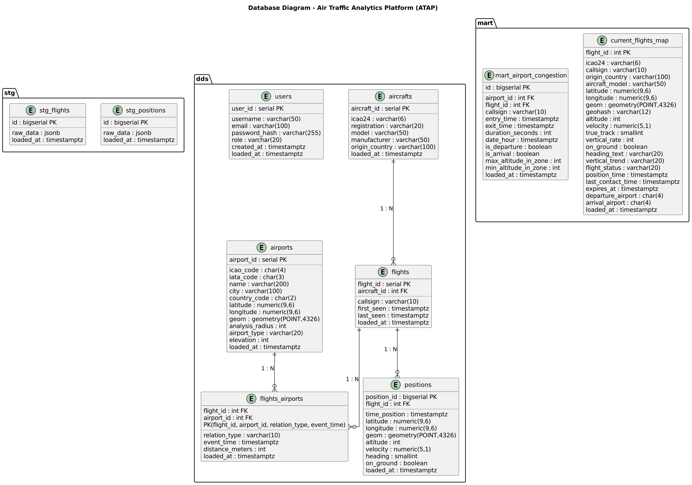

*Диаграмма в нотации DBML.*

Схемы: `stg` (сырые данные OpenSky в JSONB) → `dds` (очищенные данные, пользователи, отчёты) →
`mart` (витрина `mart_airport_congestion` и matview карты `current_flights_map`). Целостность —
через `CHECK`/`FK`. Логика витрины — хранимая процедура `calculate_airport_congestion()`.

---

## 10. Диаграммы C4

### L1: Системный контекст
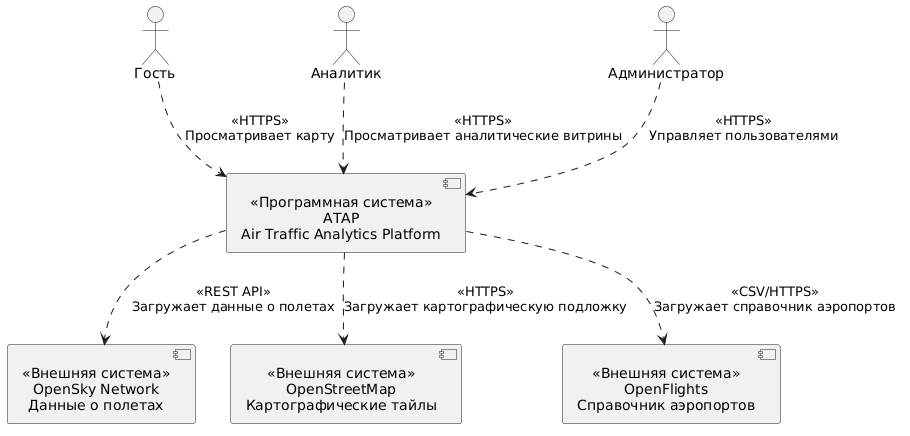

### L2: Контейнеры
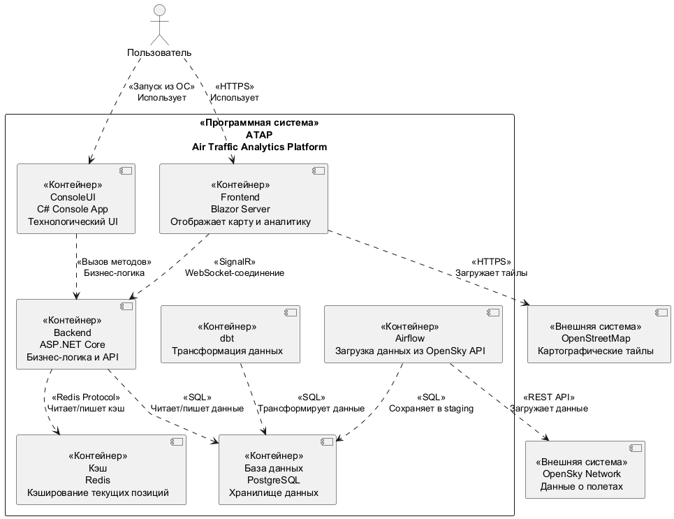

### L3: Компоненты
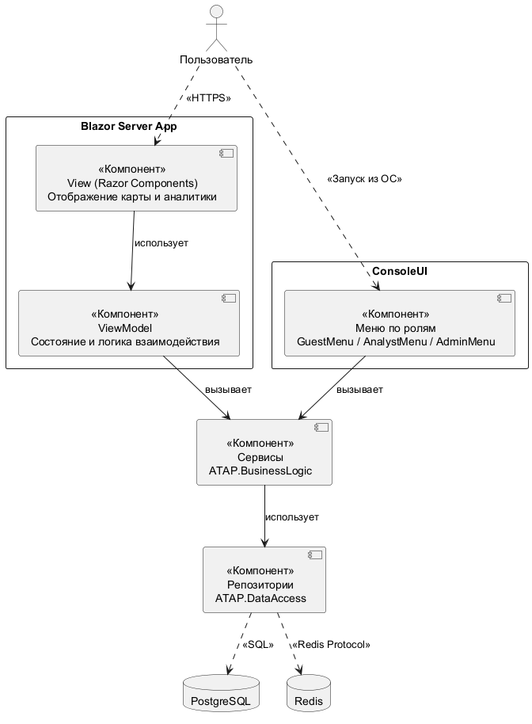

### L4: Код
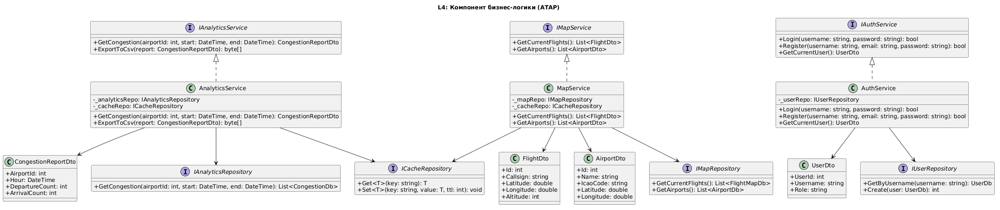

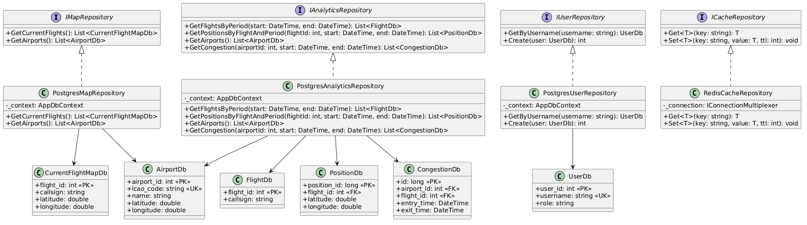

Компонент GUI (BlazorUI, MVVM). View — тонкие Razor-компоненты; ViewModel — состояние и вызовы бизнес-логики; `AppStateService` —
сессия пользователя; сервисы `ATAP.BusinessLogic` общие с ConsoleUI.

---

## 11. Черновые экраны web-приложения

Общий каркас: слева меню (Главная · Карта рейсов · Аналитика* · Мои отчёты* · Пользователи** ·
Войти/Выйти), справа содержимое. `*` — после входа, `**` — только admin.

### Главная
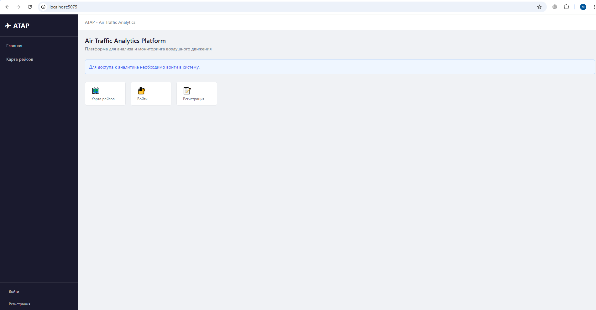

### Вход
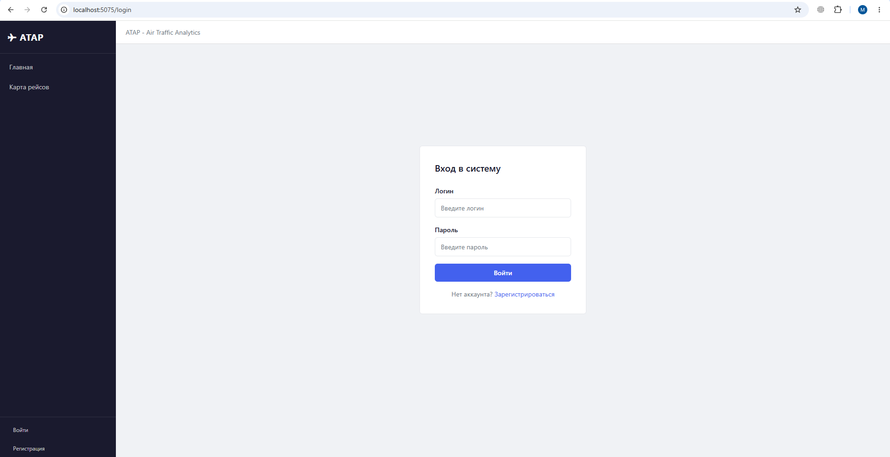

### Регистрация
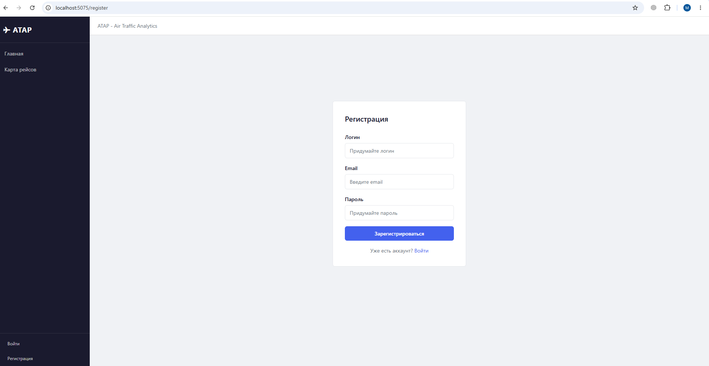

### Карта
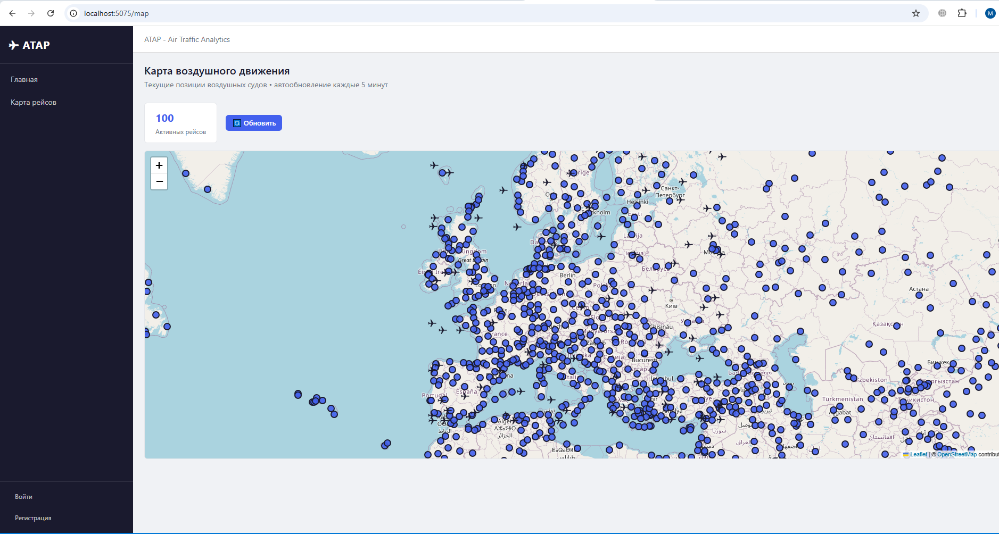

### Аналитика
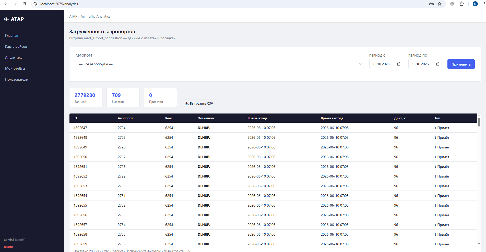

### Мои отчёты
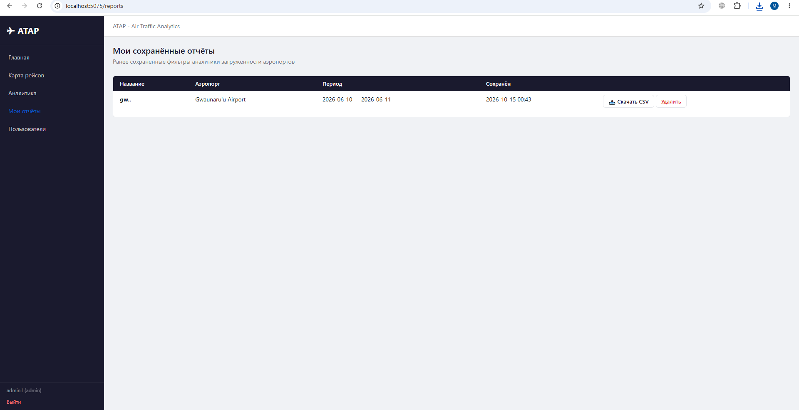

### Пользователи (админ)
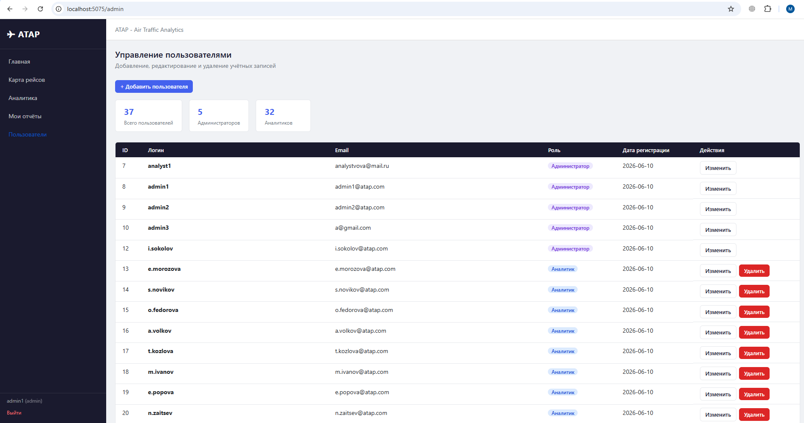

| Экран | Роль | Элементы управления | API |
|---|---|---|---|
| Вход | гость | 2 поля, кнопка | `POST /api/v1/sessions` |
| Регистрация | гость | 3 поля, кнопка | `POST /api/v1/users` (без токена) |
| Карта | все | счётчик, «Обновить», карта | `GET /api/v1/flights/current` (необязательный `?bbox=` — видимая область), `GET /api/v1/airports` |
| Аналитика | аналитик+ | список аэропортов, 2 даты, «Применить», счётчики, CSV, «Сохранить», таблица | `GET /api/v1/congestion?airportId&dateFrom&dateTo` (JSON; CSV — `Accept: text/csv`), `POST /api/v1/reports` |
| Мои отчёты | аналитик+ | таблица, «CSV», «Удалить» | `GET /api/v1/reports`, `GET /api/v1/reports/{id}/congestion` (`Accept: text/csv`), `DELETE /api/v1/reports/{id}` |
| Пользователи | админ | «Добавить», счётчики, таблица, модальное окно | `GET/POST /api/v1/users`, `GET/PUT/PATCH/DELETE /api/v1/users/{id}` |
| Меню (все экраны) | аналитик+ | имя и роль пользователя, «Выйти» | `GET /api/v1/sessions/current`, `DELETE /api/v1/sessions/current` |

Полный контракт API — [`web_lr2/openapi.yaml`](web_lr2/openapi.yaml) (OpenAPI 3.1). Кроме экранов, API даёт доступ к судам и трекам рейсов (`/api/v1/aircraft`, `/api/v1/flights/{id}/positions`) для внешних интеграций.

---

## 12. Архитектурные решения (ADR)

### ADR-0001. Хранилище: PostgreSQL + PostGIS

- **Контекст.** Нужны расстояние от судна до аэропорта, витрины по времени, целостность данных
  пользователей и отчётов, разграничение доступа. В коде есть два набора репозиториев:
  PostgreSQL и MongoDB.
- **Решение.** Единственная прод-СУБД — PostgreSQL 15 + PostGIS 3.4; MongoDB остаётся
  экспериментальным backend.
- **Альтернативы.** MongoDB — нет декларативных `CHECK`/`FK`, слабее ролевая модель.
  ClickHouse — неудобен для CRUD, потребовалась бы вторая СУБД. PostgreSQL без PostGIS — расстояния
  пришлось бы считать вручную.
- **Почему.** Один движок закрывает OLTP, геоданные и витрины; правила целостности задаются в DDL.
- **Последствия.** Масштабирование записи — вертикальное; тяжёлое обновление matview — по
  расписанию вне пиков.

### ADR-0002. Слои и два UI поверх общей бизнес-логики

- **Контекст.** Нужны веб-интерфейс и технологический консольный UI без дублирования логики;
  хранилище должно заменяться без правки сервисов.
- **Решение.** `ATAP.DataAccess` → `ATAP.BusinessLogic` → `ATAP.BlazorUI` (MVVM) и
  `ATAP.ConsoleUI`; оба UI получают одни и те же сервисы через DI. Правило: View → ViewModel → сервис.
- **Альтернативы.** Монолит с логикой в страницах — нельзя переиспользовать и трудно тестировать.
  Микросервисы — избыточны для объёма проекта.
- **Почему.** Одна логика для двух UI; СУБД скрыта за интерфейсами репозиториев (так был добавлен
  MongoDB); сервисы покрыты unit-тестами с моками.
- **Последствия.** Больше проектов и маппинга DTO.

### ADR-0003. Сборка и развёртывание

- **Контекст.** Приложению нужны PostgreSQL + PostGIS и Redis; окружение должно одинаково
  подниматься у разработчика и на сервере.
- **Решение.** Docker Compose для БД и кэша (автоинициализация `create_tables.sql`) +
  `dotnet publish` (framework-dependent) через `Makefile`. План: Dockerfile веб-приложения и единый
  `docker compose up`.
- **Альтернативы.** Self-contained single-file (один исполняемый файл со встроенной средой .NET) — крупный артефакт, не решает вопрос БД. Kubernetes —
  избыточен. Ручная установка — невоспроизводима.
- **Почему.** Compose уже используется и поднимает окружение одной командой.
- **Последствия.** DDL должен быть идемпотентным, иначе ломается инициализация контейнера.

### ADR-0004. Хранение паролей

- **Статус.** Реализовано частично: пароли хранятся в виде хэша, но через SHA-256 без соли;
  PBKDF2, соль и единый хэшер ещё не внедрены.
- **Контекст.** Пароли хэшируются SHA-256 без соли: одинаковые пароли дают одинаковый хэш,
  перебор быстрый. У тестового администратора в DDL пароль хранится в открытом виде.
- **Решение.** PBKDF2-HMAC-SHA256, ≥ 100 000 итераций, соль 16 байт; одна реализация хэшера
  вместо двух копий; при успешном входе старый хэш заменяется новым.
- **Альтернативы.** Оставить SHA-256 — не выполняет NFR-S1. SHA-256 + соль — быстрый перебор.
  bcrypt / Argon2id — нужен сторонний пакет. Внешний провайдер (Keycloak) — избыточен.
- **Почему.** PBKDF2 есть в стандартной библиотеке .NET; адаптивная стоимость — рекомендация OWASP.
- **Последствия.** Вход сильнее нагружает CPU (осознанно).

---

## 13. Связь сценариев с требованиями, сущностями и экранами

| Сценарий | Требования | Сущности | Экраны | API |
|---|---|---|---|---|
| 1. Регистрация | FR-01; NFR-S1 | Пользователь | Регистрация | `POST /api/v1/users` |
| 2. Вход / выход | FR-02, FR-03 | Пользователь, Карта | Вход | `POST /api/v1/sessions`, `DELETE /api/v1/sessions/current` |
| 3. Аналитика | FR-07…FR-12; NFR-R2 | Аэропорт, Витрина, Рейс, Сохранённый отчёт | Аналитика, Мои отчёты | `/api/v1/congestion`, `/api/v1/reports*` |
| 4. Карта | FR-04…FR-06; NFR-P1, NFR-R2 | Позиция, Судно, Рейс, Аэропорт, Карта | Карта | `GET /api/v1/flights/current` (необязательный `?bbox=` — видимая область), `GET /api/v1/airports` |
| Процесс 3 | FR-13…FR-16 | Пользователь, Сохранённый отчёт | Пользователи | `/api/v1/users*` |
| Процессы 4–5 | FR-17…FR-19 | Позиция, Рейс, Витрина | — | DAG Airflow |
